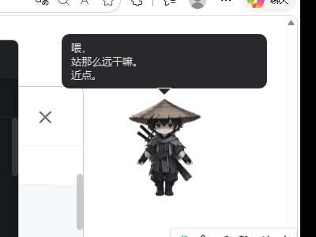
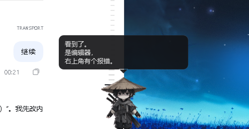
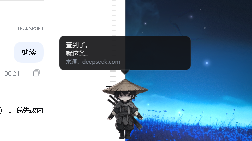
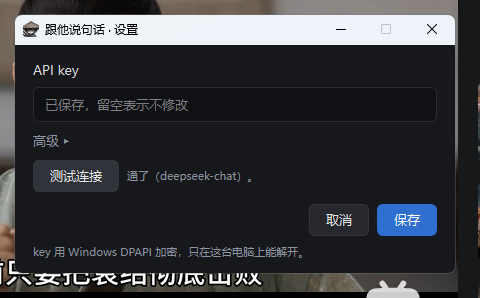
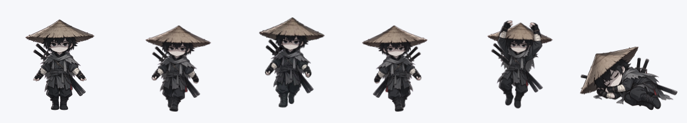
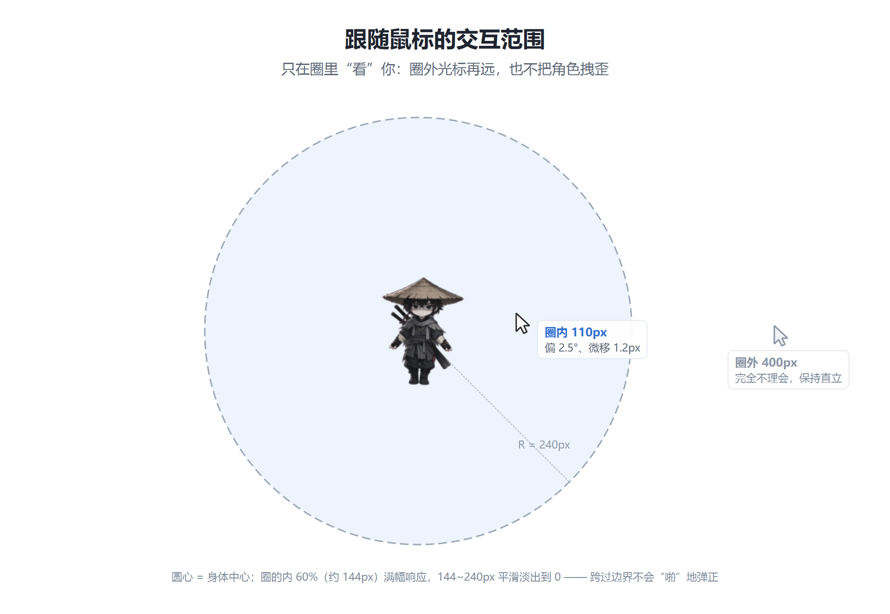

<div align="center">

# 影刃 Q 版 · Windows 桌面挂件

**一个站在屏幕角落的刀客：会呼吸、会眨眼、会挂在你屏幕顶上晃，按 WASD 原地踏步、按空格跳一下——现在还能按 Ctrl+Alt+P 跟你说话。**

[](https://github.com/xiao-bu123/yingren-desktop-pet-Q-/releases)
[](#-系统要求)
[](#-从源码运行)
[](requirements.txt)
[](LICENSE)

</div>

<div align="center">
  
</div>

<p align="center"><sub>上面这段是真实录屏：呼吸 → 按 D 原地踏步 → 松手收势，全程窗口位置没有动过。</sub></p>

---

##  下载即用（不需要装任何东西）

1. 到 **[Releases](https://github.com/xiao-bu123/yingren-desktop-pet-Q-/releases)** 下载 `yingren-pet-v2.0-win64.zip`
2. 解压，双击 **`影刃Q版.exe`**
3. 如果弹出「Windows 已保护你的电脑」→ 点 **更多信息 → 仍要运行**

> 这只是没买代码签名证书的常规提示。除了对话那一下，程序不联网、不写注册表。

**想聊天，第一次要先填一个 key**（右键 → 设置… → 粘贴 DeepSeek 的 `sk-...` → 测试连接 → 保存）。
不填也能用，只是按对话热键会弹设置窗。

##  v2.0：他会说话了

<p align="center">
  
  
</p>

<p align="center"><sub>左：头顶气泡，逐字蹦出来、最多 3 行，6 秒后自己消失。右：按 Ctrl+Alt+S 授权看一次屏幕后的回答。</sub></p>

| 热键 | 这一轮允许什么 | 请求里多了什么 |
|---|---|---|
| **Ctrl+Alt+P** | 纯聊天，什么都不给 | 无 |
| **Ctrl+Alt+S** | 看一次屏幕 | 一张截图（只在内存里活一次） |
| **Ctrl+Alt+F** | 联网查一次 | `tools: [deepseek_web_search]` |
| 消息里带 `http(s)` 链接 | 读那个链接 | `tools: [deepseek_read_url]` |

- **默认全关**。只有你按下的那一轮才有；上一轮看过的东西，下一轮就看不见了。
- 输入框在**屏幕底部居中**，右下角有个**模式灯**，点一下在 无 → 屏幕 → 联网 → 屏幕·联网 之间循环。
- 联网轮气泡底部会标一行灰色来源（下图左），正文里不会出现「我查了一下」这种话。
- 记得最近 **6 轮**（12 条消息），24 小时过期；右键「忘掉刚才的对话」可清空。
- 双击角色 = Ctrl+Alt+P；输入框开着时按 `S` / `F` 也能切换授权，两种可以叠加。

<p align="center">
  
  
</p>

<p align="center"><sub>左：联网轮的气泡，底部标来源。右：设置窗，key 用 Windows DPAPI 加密，只在这台电脑能解开。</sub></p>

##  它到底做了什么

| | |
|---|---|
|  **呼吸** | 3.2 秒一个周期，纵向 1.00→1.02，以**脚底为支点**缩放（不会像气球一样上下飘） |
|  **眨眼** | 每 3~6 秒随机眨一次，闭眼 0.15 秒；睡眠中不眨眼 |
|  **拖着走** | 跟手不做插值，按水平速度左右倾斜 ±6°；松手 0.25s 加速下落 + 回弹，不是瞬移 |
|  **挂在屏幕顶** | 拖到屏幕上边缘松手，单手抓住屏幕挂住，绕**拳心**做 ±2°、2.6s 的钟摆；单击才松手 |
|  **空格跳跃** | 蓄力 → 腾空 0.5s（最高 70px）→ 落地压扁回弹，落点和起跳点误差 **0px** |
|  **键盘踏步** | 任意窗口按 `W`/`A`/`S`/`D` 原地踏起来，`Shift` 加速；`A` 朝左镜像、`D` 朝右 |
|  **跟着鼠标看** | 只在身体周围 **240px** 的圈里理你：圈内朝光标轻偏 ±3°，越靠圈边越轻，出圈立刻回正 |
|  **会说话** | 头顶气泡逐字蹦、最多 3 行、6 秒淡出；鼠标停上去暂停计时 |
|  **看屏幕** | 按 Ctrl+Alt+S 才截、只截一张、只在内存里、不落盘、不进记忆；全屏游戏会直说「看不见」 |
|  **联网查** | 按 Ctrl+Alt+F 只在该轮开工具，5 行上限、来源脚注；不按就完全断网 |
|  **滑杆缩放** | 右键菜单里一条滑杆，22%~35% 连续可调，脚底钉在原地 |
|  **会累** | 闲置 5 分钟趴下睡着（呼吸放慢到 4.5s），点一下就叫醒 |
|  **点击穿透** | 只有不透明像素能点，透明区域直接打穿到下层窗口 |
|  **不打扰** | 不进任务栏、不抢焦点、没有控制按钮；所有设置都在右键菜单和托盘里 |

<p align="center">
  
</p>

<p align="center">
  
  <br>
  <sub>从左到右：挂在屏幕顶、悬挂时的另一帧、空格腾空</sub>
</p>

<p align="center">
  
  <br>
  <sub>只对进入身体周围 240px 的光标有反应：圈内 60% 满幅，靠边渐弱，出圈回正</sub>
</p>

##  第一次用：填 key（只填一次）

1. 右键角色（或托盘图标）→ **设置…**
2. 粘贴 DeepSeek 的 `sk-...` → **测试连接**，显示「通了」就对了 → **保存**
3. 也可以直接编辑 `chat.ini`，把 key 粘到 `key_plain =` 后面；设置窗保存后会改成 Windows DPAPI 加密的 `key_cipher`

`base_url` / `model` 收在「高级」里，默认 `https://api.deepseek.com/v1` + `deepseek-flash`（支持图片和联网工具）。
换电脑后 DPAPI 解不开，会提示「这台电脑上没找到你的 key，重新粘一次」——不是 key 错了。

##  操作

| 操作 | 行为 |
|---|---|
| **Ctrl+Alt+P / S / F** | 屏幕底部弹出输入框（纯聊天 / 看屏幕 / 联网） |
| **双击角色** | 等同 Ctrl+Alt+P；睡着时先叫醒 |
| 左键按住拖动 | 悬空姿势贴着光标走，按水平速度倾斜 ±6° |
| 松开左键 | 0.25s ease-out 向下落一段 + 缩放 1.02→1.00 回弹 |
| 左键单击 | 睡着时叫醒 / 醒着时眨一次眼；**悬挂时 = 松手落地** |
| 滚轮 | 缩放 ±1%（22%~35%），以脚底为锚点 |
| 右键 | 跟它说句话 / 忘掉刚才的对话 / 设置 / 永远置顶 / 缩放滑杆 / 立即睡觉 / 键盘控制 / 隐藏到托盘 / 退出 |
| `W` `A` `S` `D` | 原地踏步（窗口不动），按住 `Shift` = 跑 |
| `空格` | 原地跳：蓄力 0.12s → 腾空 0.5s → 落地 0.12s，落点精确回到起跳点 |
| 拖到屏幕最顶部松手 | 抓住屏幕上边缘挂住（窗口顶边距可用区顶边 < 24px 时触发） |
| 托盘图标单击 | 显示 / 隐藏 |

**悬挂时的规矩**：只有单击角色才会松手，直接拖动可以带走；`空格` / `WASD` / 双击在悬挂时一律无反应。
**对话中**（输入框开着 / 等回复 / 输出中）角色动作静音：按空格不会跳、按 WASD 不会走，但热键和 Esc 照常可用。

##  隐私

- **只有你按 Ctrl+Alt+S 的那一下**，屏幕才会被截一次，而且图**只在内存里活一次**，不落盘、不进记忆。
- 没有定时截屏、没有关键词触发、没有后台采集；代码里只有这一个入口。
- 截到的内容会发给你自己配置的 API 供应商（和你粘贴一段文字给它没有区别）。屏幕上有密码、聊天记录、银行页面时，别按。
- 联网轮会把你的问题发给搜索工具；答案来源会以小字标出。
- 对话历史明文存在你自己电脑上的 `chat_history.json`，不上传到别处。

## 🛠 从源码运行

```bash
git clone https://github.com/xiao-bu123/yingren-desktop-pet-Q-.git
cd yingren-desktop-pet-Q-
pip install -r requirements.txt
python pet.py
```

Windows 上也可以直接双击 `start.bat`（用 `pythonw` 启动，任务栏里不会多一个黑框）。
想看到实时日志和帧率就用 `start_debug.bat`。

##  系统要求

- Windows 10 / 11 64 位（下载 exe 的用户**不需要**装 Python 或 Qt）
- 从源码运行需要 Python 3.10+ 与 PySide6 6.6+（见 `requirements.txt`）
- 聊天需要自己准备一个 DeepSeek API key；不填只能用挂件动作
- 玩游戏请用「无边框窗口全屏」：独占全屏下挂件和气泡画不出来，截图也只会是黑图

##  换素材 / 改人设

把 `assets/` 里的同名 PNG 换掉即可（1536×1536 透明 PNG），代码会**自动重新计算脚底锚点**：

| 文件 | 用途 |
|---|---|
| `idle.png` | 站立睁眼（主姿态） |
| `blink.png` | 站立闭眼（与 idle 除眼睛外完全一致，插帧不会跳） |
| `drag.png` | 悬空，双手举过头顶 |
| `sleep.png` | 侧趴睡着 |
| `walk_01.png` / `walk_02.png` | 原地踏步的两帧（同高、同底边、同中心） |
| `hang.png` | 单手抓住上方（拳心就是悬挂的支点） |
| `jump_air.png` | 腾空，双腿收起 |
| `icon.png` | 托盘图标 256×256 |
| `persona.md` | **人设**：认主、冷的夸、授权式感知；改这里不用改代码 |

某个动作的素材缺失时只会关掉对应动作，不影响启动。打包成 exe 后想换素材，在 exe 同目录建 `assets/` 放同名文件即可覆盖。

##  想调手感

挂件参数在 `pet.py` 顶部的 `CONFIG` 类；对话参数在 `chat.ini`（`temperature`、`max_tokens`、`max_turns`、
`history_hours`、超时、`hotkey`、`vision_enabled` / `search_enabled` 等）；人设改 `assets/persona.md`。改完重启即可。

##  实现上比较讲究的几处

- **点击穿透**：按「形变包络」（呼吸最高点、倾斜两端、踏步颠簸、悬挂 ±2°、跳跃 0.90~1.03、对话 ±1px 浮动）
  渲染 `QRegion` 再 `setMask()`，按 `(形状族, 缩放, DPI)` 缓存 —— 整套动画遮罩**零重建**。
- **气泡**：`WindowTransparentForInput` + `WA_TransparentForMouseEvents`，实测 `WS_EX_TRANSPARENT=True`，
  点击直接穿到下层；悬停靠 100ms 全局光标采样，必须「先出去、再进来」。
- **对话线程**：`chat_core` 用 `urllib` 读 SSE，连接超时 10s、读超时 20s/40s；取消时同时置标志位并关连接；
  每轮一个 `gen` 代号，旧线程的回调不会串到新气泡里。
- **抢焦点**：输入框用 `AttachThreadInput + SetForegroundWindow` 提到前台（输入法只认有焦点的窗口），
  关闭后把焦点还给打开前的窗口。
- **前缀缓存**：system prompt（人设 + 三段补充）启动时构建一次，之后一字不改；
  「本轮有没有图 / 联网」走 user 消息里的状态行，不进 system。
- **键盘**：Win32 `GetAsyncKeyState` 只读轮询（每 2 帧一次），不是全局钩子、不拦截、不吞字。

实测（1920×1080 / 100% 缩放，i7 级别 CPU）：

| 场景 | CPU（单核） | CPU（全核） | 内存 |
|---|---|---|---|
| 静止（30 帧） | ~2.1% | **0.13%** | 213 MB |
| 气泡显示中 | ~1.9% | 0.12% | 213 MB |
| 原地踏步（60 帧） | ~5.9% | 0.37% | 213 MB |

##  自己打包

```bash
pip install pyinstaller
python build_exe.py      # → dist/影刃Q版.exe（约 41 MB，单文件）
python make_release.py   # → release/yingren-pet-v2.0-win64.zip
```

##  目录结构

```
.
├── pet.py              # 挂件本体：窗口 / 状态机 / 绘制 / 键盘 / 菜单
├── chat_core.py        # 对话内核：配置、DPAPI、记忆、SSE、图片/工具、来源（不 import PySide6）
├── chat_ui.py          # 对话界面：底部输入框 / 气泡 / 设置窗 / 模式灯 / 截图
├── assets/             # 9 张素材 + persona.md
├── docs/               # README 用的图
├── start.bat           # 双击启动（pythonw，无黑框）
├── start_debug.bat     # 带控制台启动，能看 pet.log
├── build_exe.py        # 打包成免安装 exe
├── make_release.py     # 生成 Release 用的 zip
├── requirements.txt
├── CHANGELOG.md
└── LICENSE
```

##  FAQ

**按 Ctrl+Alt+P 没反应？**
先看 `pet.log` 有没有「对话模块已加载」；托盘被隐藏时热键不工作，先单击托盘叫回来。
热键撞游戏的话，改 `chat.ini` 的 `hotkey=`（`alt+p` / `ctrl+shift+p` / `f9`）。

**按热键弹出的是设置窗？**
还没填 key（或换电脑后 DPAPI 解不开）。填完保存，再按一次热键。

**按 S 回「看不了」/ 按 F 回「查不了」？**
`chat.ini` 里 `vision_enabled` / `search_enabled` 被关了。

**按 S 回「你开的是全屏，我看不见」？**
独占全屏游戏截出来是黑图；改用无边框窗口模式。

**气泡不消失？**
鼠标停在气泡上会暂停 6 秒计时；挪开就走。

**按 WASD 没反应？**
右键菜单看「键盘控制」是不是被关掉了；睡着状态故意不响应键盘，点一下叫醒。

**怎么彻底退出？**
右键 → 退出，或托盘菜单 → 退出。位置、缩放和键盘开关都会记住。

**第一次启动要等一两秒？**
one-file 打包会把程序解压到 `%TEMP%`，属正常现象。

##  许可与致谢

代码 [MIT](LICENSE)。

角色立绘是《影之刃零》主角「魂」的同人二创，版权归原权利方所有，**仅限个人学习交流、禁止商用**；
MIT 许可不覆盖 `assets/` 下的图片，要用于其他用途请自行替换。

如果你觉得有意思，点个 Star ⭐ 就好。
