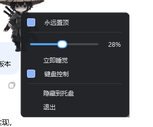

# 影刃 Q 版 · Windows 桌面挂件

> 一个站在屏幕角落的刀客：无边框、透明、永远置顶，会呼吸、会眨眼、能被拖着走，还会在你按 WASD 时原地踏步。
> An always-on-top, click-through desktop pet for Windows — a single 1.5k-line PySide6 file.


<p align="center">
  
</p>

## ✨ 功能

- **活着的感觉**：3.2 秒周期的呼吸（纵向 1.00→1.02，以脚底为支点）、每 3~6 秒眨一次眼、闲置 5 分钟趴下睡着。
- **拖着走**：按住左键跟着光标走、按水平速度左右倾斜 ±6°；松手往下坠一小段再落地回弹，不是瞬移。
- **右键滑杆缩放**：22%~35%（角色 95~151px 高）连续可调，脚底钉在原地不乱飘。
- **键盘踏步**：在任意窗口按 `W`/`A`/`S`/`D` 原地踏起步来，按住 `Shift` 变成跑；`A` 朝左、`D` 朝右。
  窗口位置**一动不动**，所有位移都在绘制层。
- **真正的点击穿透**：只有不透明像素可点，透明区域完全打穿到下层窗口。
- **不打扰**：不进任务栏、不抢焦点、不联网、不写注册表；只有托盘图标和右键菜单。

## 📥 直接用（不需要装任何东西）

1. 下载 [Releases](releases) 里的 `影刃Q版-v1.1-win64.zip`
2. 解压，双击 `影刃Q版.exe`
3. 首次运行如果弹出「Windows 已保护你的电脑」，点 **更多信息 → 仍要运行**（没买代码签名证书，都会这样）

单文件 38MB，自带 Python 与 Qt；`settings.ini`、`pet.log` 就生成在 exe 旁边。

## 🛠 从源码跑

需要 **Python 3.10+**（Windows 10/11 64 位）：

```bash
pip install -r requirements.txt
python pet.py
```

也可以直接双击 `start.bat`（用 `pythonw` 启动，不会留一个黑框在任务栏）。

## 🎮 交互

| 操作 | 行为 |
|---|---|
| 左键按住拖动 | 悬空姿势贴着光标走，按水平速度倾斜 ±6° |
| 松开左键 | 0.25s ease-out 向下落一段 + 缩放 1.02→1.00 回弹 |
| 左键单击 | 睡着时叫醒 / 醒着时眨一次眼 |
| 左键双击 | 睡着 ↔ 醒来 |
| 滚轮 | 缩放 ±1%（22%~35%），以脚底为锚点 |
| 右键菜单 | 永远置顶 / 缩放滑杆 / 立即睡觉 / 键盘控制 / 隐藏到托盘 / 退出 |
| `W` `A` `S` `D` | 原地踏步（窗口不动），`Shift` = 跑 |
| 托盘单击 | 显示 / 隐藏 |

## 🖼 换素材

把 `assets/` 里的同名 PNG 换掉就行（1536×1536 透明 PNG），代码会自动重新计算脚底锚点：

| 文件 | 用途 |
|---|---|
| `idle.png` | 站立睁眼（主姿态） |
| `blink.png` | 站立闭眼（与 idle 除眼睛外完全一致） |
| `drag.png` | 悬空，双手举过头顶 |
| `sleep.png` | 侧趴睡着 |
| `walk_01.png` / `walk_02.png` | 原地踏步的两帧（同高、同底边、同中心） |
| `icon.png` | 托盘图标 256×256 |

打包成 exe 后想换素材，不用重新打包：在 exe 同目录建一个 `assets/` 放同名图片即可覆盖内置素材。

## ⚙️ 调参数

所有手感参数都在 `pet.py` 顶部的 `CONFIG` 类里：缩放下限/上限、呼吸周期与幅度、眨眼间隔、
踏步帧时长与颠簸幅度、拖拽倾斜增益、落地时长、初始位置边距……改完重启即可。

## 🧱 实现要点

- **窗口**：`FramelessWindowHint | WindowStaysOnTopHint | Tool | NoDropShadowWindowHint | WindowDoesNotAcceptFocus`
  ＋ `WA_TranslucentBackground`。实测扩展样式为 `WS_EX_TOPMOST | WS_EX_TOOLWINDOW | WS_EX_LAYERED`、
  `WS_EX_APPWINDOW` 为假 —— 所以压得住浏览器、不进任务栏、不抢焦点。
- **点击穿透**：按「形变包络」（呼吸最高点、倾斜两端、踏步颠簸上下限）渲染出 `QRegion` 再 `setMask()`，
  结果按 `(形状族, 缩放, DPI)` 缓存，动画过程中零重建。
- **性能**：`PreciseTimer` 驱动，60 帧（拖拽/踏步）与 30 帧（静止）自动切换；重绘只在姿态真的变化时发生。
  实测空闲 0.12%、踏步 0.37%、拖拽 0.6%（全核口径），内存约 110MB，遮罩重建 0.35ms。
- **DPI**：按 `devicePixelRatio` 预渲染位图（150% 缩放下按 537px 渲染），几何与样式全部走逻辑像素。
- **键盘**：`GetAsyncKeyState` 只读轮询（每 2 帧一次），不拦截、不注入、不需要管理员权限。

## 📁 目录结构

```
.
├── pet.py              # 全部逻辑（单文件，中文注释）
├── assets/             # 7 张素材
├── start.bat           # 双击启动（pythonw）
├── start_debug.bat     # 带控制台启动，能看 pet.log 输出
├── build_exe.py        # 打包成免安装 exe（PyInstaller）
├── make_release.py     # 生成 Release 用的 zip
├── docs/               # README 用的图
├── requirements.txt
└── CHANGELOG.md
```

## 📦 自己打包

```bash
pip install pyinstaller
python build_exe.py      # → dist/影刃Q版.exe
python make_release.py   # → release/影刃Q版-vX.Y-win64.zip
```

## ⚠️ 已知限制

- 只支持 Windows（用到了 Win32 的置顶/分层窗口/键盘轮询；键盘功能在其他平台会自动禁用）。
- 不压全屏游戏和 UAC 界面（Windows 的置顶窗口本来就这样）。
- 打包用的是 one-file 模式，启动时要把程序解压到 `%TEMP%`，首次启动慢 1~2 秒；
  极端受限的环境可以改用 `--onedir`。
- 睡觉状态下按键盘不会唤醒（否则打字会一直把它吵醒），点一下就叫醒。

## 📄 License

代码 [MIT](LICENSE)。

角色立绘是《影之刃零》主角「魂」的同人二创，版权归原权利方所有，**仅限个人学习交流、禁止商用**；
MIT 许可不覆盖 `assets/` 下的图片。
